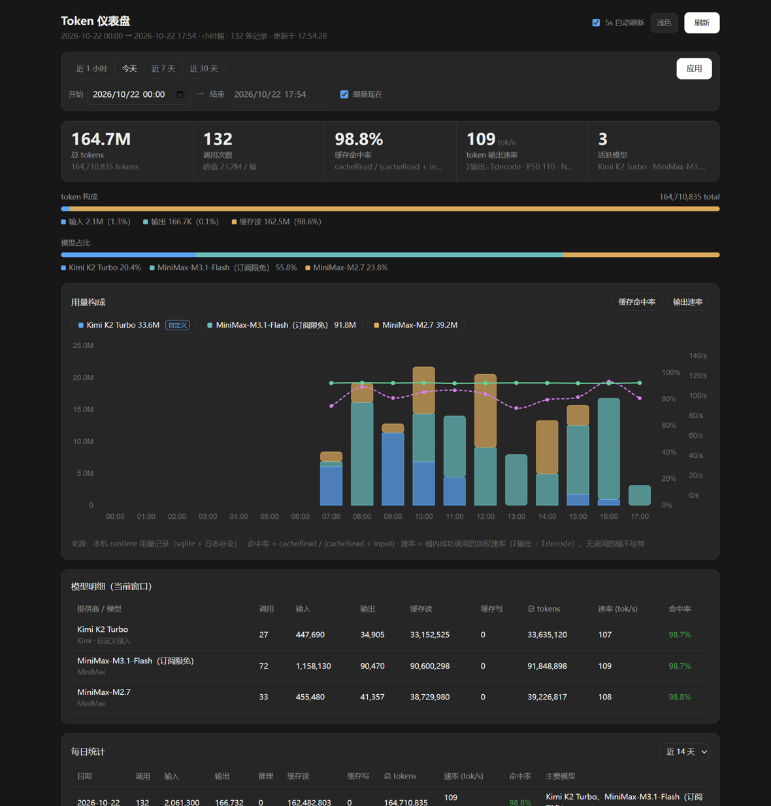

# Token 仪表盘

[English](README.md) | 简体中文

本机 MiniMax Code 的实时 token 用量看板。读的是运行时自己的**逐次调用台账**与观测日志，所以展示的就是客户端真实记录的数字，而不是从会话文件里反推出来的估算值。

作者：[HaneWari](https://github.com/HaneWari) · 版本：`1.10.0` · 许可证：[Apache-2.0](LICENSE)



*预览中的会话与用量均为合成数据。应用界面为中文。*

> [!IMPORTANT]
> **这是一个非官方的社区项目。** 它不是 MiniMax 制作、审核、认可或发布的，也没有经过官方 Mini App 评审；它直接由本仓库分发。
>
> 安装前请先读[数据与访问](#数据与访问)：本版本会读取客户端的**内部存储文件**（运行时 SQLite 数据库、观测日志、`config.yaml`），而这些结构可能在任何一次客户端更新中改变。

## 能看到什么

- **用量趋势** —— 按模型堆叠的柱状图，缓存命中率与输出速率两条曲线叠绘在柱状图之上。窗口拉长时分桶自动从分钟级过渡到小时级、天级。
- **五张明细表** —— 模型明细、每日统计、12 列的**逐次调用台账**、**对话明细（turn 级）**、会话用量排行。
- **对话明细** —— 你每次提问占一行：用户消息原文、状态、挂钟时长、这一轮消耗了几次模型调用、五类 token、速率。**正在进行中的一轮会实时增长并标记为「未收尾」，无需关闭会话。**
- **逐次调用台账** —— 每一次模型调用都有一行：精确时间、模型、五类 token、输出速率、全程速率、decode 时长、请求全程、状态码。
- **时间窗口** —— 近 1 小时 / 今天 / 近 7 天 / 近 30 天，或自定义起止时间。时间栏排成两行，保证原生日期选择器向下弹出时不会盖住「应用」按钮；在时间框里按 Enter 同样能应用。
- **5 秒自动刷新**（也可手动点「刷新」）。切换窗口时旧数据留在屏幕上不空表，新值到达即替换；晚到的旧窗口响应会被丢弃，不会覆盖新窗口。
- **被删除的会话仍然留在看板上。** 在客户端里删掉一次对话，会连同它的用量行、消息行和会话记录文件一起消失——事后没有任何地方可以再读回来。看板因此在宿主为插件提供的可写目录里保存一份自己的副本，把被删除的会话从这份归档里补回并标记为**「已删除」**。运行时的数据库本身从不被写入。

## 为什么是这一个

同类看板大多只回答「我花了多少」。这个看板同时回答「花到哪去了」，以及「我看到的这个数，是不是客户端自己显示的那个数」。

- **读台账，不读会话文件。** 数据来自运行时自己的逐次用量表和观测日志，而不是从会话记录文件里反推。会话记录文件里每条 assistant 消息只带一段汇总用量、且完全没有计时信息，所以读它的看板既看不到那些根本没写进会话文件的调用，也永远给不出「每一次调用」的速度——因为文件里没有计时。实测对照（参考机器，同机对比一款读会话文件的看板）：它整体**少报约 48% 的调用、少报约 66% 的缓存读 token**，且按天在 **0%~98%** 之间剧烈波动。根因不是「一消息一聚合」这类统计规则，而是**部分会话根本没留下会话文件**，读文件的看板无从看到。
- **输出速率与客户端同口径。** 输出速率取 `Σ输出 tokens ÷ Σdecode 时长` —— 只算首 token 到流结束的解码段，与 MiniMax Code 界面显示一致。全程速率作为对照列并排给出，可以直接看出每次调用有多少时间耗在等首 token 上。若改用请求全程计算，得到的数字会低约 **1.6~2.1 倍**，且与界面数字对不上。
- **每次调用都配回自己的计时。** 看板把每条用量行与携带该次调用 decode / 请求全程时长的那条 assistant 消息配对，既不按时间就近匹配、也不按下标顺序匹配——这两种方式只要一个 turn 里混进一条「不是模型调用」的 assistant 行（上下文压缩就会写这种行）就会整轮错位。此处的配对规则已用 token 签名做真值、在 **16,723 次调用上逐条核对，错配 0 条**。
- **总 token 算满五项。** `总 = 输入 + 输出 + 推理 + 缓存读 + 缓存写`。只算三项的看板会悄悄漏掉缓存写与推理 token。
- **turn 级粒度。** 一次提问就是一行，带这一轮实际花掉的调用次数与 token，不需要等会话结束或归档。
- **不装 Python、不起额外进程、无第三方依赖。** 纯 Node，除了一份本地化的 Chart.js 之外没有第三方运行时代码。同生态里另一款看板需要 Python 3.8+，并且每次查询都要拉起一个 Python 进程。
- **毫秒级，不是秒级。** v1.7.0 的缓存重构之后，整页刷新从约 8.5 秒降到几十毫秒。在 1.7 万行消息表的参考机器上：整页刷新约 **50 毫秒**，切到 7 天窗口约 **40 毫秒**，全新进程里的第一次查询约 **1.3 秒**（那次必须把消息表扫一遍）。
- **对运行时严格只读。** 看板从不写入客户端的数据库、观测日志或配置，不发任何请求，无遥测。唯一的写入是它自己那份归档文件，且位于插件自己的数据目录里。无需账号、无需 API Key、无需任何配置。

## 与另外两款 token 看板的差别

MiniMax Code 社区里还有另外两款 token 看板，各有所长，解决的也略有不同：

| | Token 仪表盘（本款） | `mcode-token-usage-board` | `mcode-usage-monitor` |
| --- | --- | --- | --- |
| 数据来源 | 运行时用量表 + 观测日志 | 会话记录文件（`messages.jsonl`） | 运行时数据库，经 Python 3.8+ 读取 |
| 逐次调用计时 | 有 —— 每次调用的 decode、请求全程、状态码 | 无 —— 会话文件里没有计时 | 部分有 —— 每次请求的速度 |
| 逐次调用台账 | 有，12 列 | 无 | 只有近期请求列表 |
| 带用户原文的对话（turn）明细 | 有 | 无 | 无 |
| 需要 Python | 否 | 否 | 是 |
| 每次查询另起进程 | 否 | 否 | 是 |
| 自动刷新 | 5 秒 | 60 秒 | 5 秒 / 10 秒 / 30 秒 |
| 布局 | 固定、信息密集 | 固定 | 可拖拽重排的卡片布局 |

实际差别在于：如果你想知道**某一次具体对话的 token 花在哪**，或者要**核对某一次具体调用**（它的 decode 时长、请求全程、HTTP 状态码），只有本款看板能给——而且不必再去从会话文件里反推。若你更看重自由重排的卡片布局，那 `mcode-usage-monitor` 更合适。

## 安装

> [!WARNING]
> Mini App 的代码以你的用户身份在本机运行，宿主也没有使用操作系统级沙箱。请只安装来源可信的包——并先读[数据与访问](#数据与访问)，清楚它会碰哪些东西。

有三条路，按需选一条。

### A. 从 Releases 下载 ZIP，交给 Agent

到 [Releases](https://github.com/HaneWari/mcode-token-meter/releases) 下载 `token-meter-board-v1.9.0.zip` 并解压。然后把解压后的目录**或者**那个 ZIP 直接交给 MiniMax Code 的 Agent，让它按**成品包流程**发布，Agent 会替你复制到 `<dataDir>/plugins/token-meter-board/`。

> [!NOTE]
> ZIP 的根目录直接包含 `.minimax-plugin/plugin.json`。请原样解压，不要在外面再套一层目录。

### B. 手动复制目录

克隆或下载本仓库，然后把**整个插件目录**——包括隐藏的 `.minimax-plugin` 目录——复制到：

```text
<dataDir>/plugins/token-meter-board/
```

| 系统 | 目标路径 |
| --- | --- |
| Windows | `C:\Users\<用户名>\.minimax\plugins\token-meter-board` |
| macOS | `/Users/<用户名>/.minimax/plugins/token-meter-board` |
| Linux | `/home/<用户名>/.minimax/plugins/token-meter-board` |

`<dataDir>` 是当前 MiniMax Code 数据目录——默认是主目录下的 `.minimax`，或 `MINIMAX_DATA_DIR` 指向的目录。

如果你是克隆本仓库拿到的，**仓库根目录本身就是插件目录**，所以要把仓库根目录复制进 `plugins/token-meter-board/`。两个常见错误：复制成 `plugins/token-meter-board/token-meter-board/`，以及中间多留一层 `plugins/<你的 GitHub 用户名>/`。

### C. 直接克隆到插件目录

```bash
git clone https://github.com/HaneWari/mcode-token-meter.git ~/.minimax/plugins/token-meter-board
```

### 然后

重启 MiniMax Code，确认插件已出现并处于启用状态，然后打开 **Token 仪表盘**，或在对话里让 Agent 打开。

> [!NOTE]
> **桌面端的「从 GitHub 导入插件」入口不支持 Mini App 包。** 任何 Mini App 都得用上面三条路之一手动安装。

## 使用

选一个时间窗口（预设或自定义），然后看趋势图、KPI 与下方五张表。模型 chips 可同时筛选图表与表格；会话排行与每日统计各自带独立的时间范围选择器，改主窗口不会牵连它们。页面每 5 秒自动刷新，也可手动点「刷新」。

示例提问与对应结果：

- **「打开 Token 仪表盘」** → 直接打开当前窗口的看板。
- **「查看我的模型用量趋势」** → 按模型堆叠的趋势图，含缓存命中率曲线与输出速率曲线。
- **「哪个自定义模型的缓存命中率最高？」** → 模型明细表，逐 provider / 模型给出缓存命中率。

看板还带一个 **「让 Agent 分析此窗口」** 按钮：把当前窗口的总量、调用次数、缓存命中率与输出速率填进聊天输入框，你可以对着刚看过的同一份数字继续追问。

## 数据与访问

> [!IMPORTANT]
> **本版本读的是客户端的内部存储，不是公开 API。** 它直接打开运行时 SQLite 数据库、观测日志文件与 `config.yaml`。这些路径、表结构与字段名都是客户端的私有实现，可能在任何一次客户端更新中改变；一旦改变，这个看板就会失效，直到有人跟进适配。官方 Mini App 包评审不覆盖本版本，因为它不是走官方渠道分发的——是否接受这个取舍，由你自己判断。
>
> 它另外会**写出一个属于它自己的文件**——一份它见过哪些调用的本地归档——因为客户端删除会话时会把用量行一并删掉。具体是什么文件、放在哪里，见下面的[会写出什么](#会写出什么一个文件放在插件自己的目录里)。

**读取的文件（只读，绝不修改）：**

| 路径 | 用途 |
| --- | --- |
| `<dataDir>/v2/sqlite/runtime-state.sqlite` | 逐次调用用量台账，以及 assistant / user 消息行（decode 计时、结束原因、消息原文）。用 `node:sqlite` 以只读模式打开。 |
| `<dataDir>/v2/observability/logs/runtime-*.log` | provider、模型与响应状态，按 turn 关联。用量表本身不存模型名，日志正是自定义（BYOK）provider 能显示成自己的名字而不是 "unknown" 的原因。 |
| `<dataDir>/config.yaml` | provider 与模型的显示名，让表格显示 "MiniMax-M3.1-Flash" 而不是内部 id。 |

路径由 Host 注入的 `context.dataDir`（当前 MiniMax Code 数据目录）解析，缺失时回退到 `~/.minimax`。**这些路径和运行时数据库的表结构都不是公开 API**，属于客户端内部存储，未来版本可能变化。真发生变化时看板会给出明确报错，而不是给你一张空表。

**页面上会显示什么。** 看板渲染的是本机真实数据，所以一张截图里可能包含：

- **你自己提问的原文** —— 对话明细会显示每一轮用户消息的**前 200 字**。原文不会被完整读取：截断发生在数据库查询内部，原文既不进入应用内存，也不会传到浏览器。
- **会话标题与会话 id**，以及每个会话的**工作区绝对路径**（显示在会话排行的悬浮提示里）。
- **模型与 provider 名称**，包含你自己接入的自定义（BYOK）provider 名称。

这些内容都留在本机与这个页面上。若打算分享截图，请记得里面也有你自己的提问和本机目录名。

**会写出什么——一个文件，放在插件自己的目录里。** 在客户端里删除会话是**硬删除**：宿主自己的 `SessionArtifactService.deleteSession` 会把该会话的用量行、消息行和 transcript 目录一起删掉，事后没有任何地方可以再读回来。因此看板在宿主为插件提供的可写目录里保存一份它见过的每一次模型调用的副本：

```text
<dataDir>/v2/plugin-data/liveboards/token-meter-board/archive.sqlite
```

| 写出 | 位置 | 内容 |
| --- | --- | --- |
| `archive.sqlite` | 插件自己的数据目录（宿主提供，随插件一起卸载） | 每次模型调用一行——token、时间戳、会话、turn，以及它被显示时的模型名 / decode 计时 / HTTP 状态码；另含会话标题，以及看板展示过的每条用户消息的前 200 字 |

运行时的数据库、观测日志与 `config.yaml` **只被读取**。归档是副本而非替代：运行时仍然存在的会话一律以运行时为准，只有运行时已经不拥有的调用才会从归档里合并回来。若归档写不进去（例如目录只读），看板照常工作，只是被删除的会话无法补回。

除这一个文件外不落任何数据：数据不出本机，无遥测。浏览器 `localStorage` 里只存一样东西：主题选择，键名 `tmb-theme`。

**网络：** 无。Mini App 只在 `127.0.0.1` 上提供一个页面并响应自己的 API 路由，从不访问任何远端主机，除自身源外不发起任何请求。API 接受的查询参数是**逐端点白名单**：其余参数（含任何试图指定数据目录的参数）在进入查询前就会被丢弃。

**子进程：** 通常没有。若宿主 Node 运行时没有暴露 `node:sqlite`，Mini App 会用子进程重跑完全相同的只读查询：先尝试 `PATH` 上的 `node`，只有该可执行文件不存在时才回退到用 `ELECTRON_RUN_AS_NODE=1` 拉起自身可执行文件。查询模式与参数以 argv 数组传入，**绝不经过 shell**；子进程向 stdout 输出一个 JSON 文档后退出。

**Node.js：** 进程内路径需要 `node:sqlite`（Node.js 23.4 起不再需要 flag）。测试时随附的运行时是 Node.js v24.18.0。若进程内运行时与子进程都没有它，看板会明确报出这个要求，而不是静默失败。

## 指标口径

| 指标 | 定义 |
| --- | --- |
| 总 tokens | `输入 + 输出 + 推理 + 缓存读 + 缓存写` |
| 缓存命中率 | `缓存读 ÷ (缓存读 + 输入)`，即提示词中命中缓存的比例；缓存写不计入分母。 |
| 输出速率 | `Σ输出 tokens ÷ Σdecode 时长`，按耗时加权。单次调用为 `输出 tokens ÷ decode 时长`（首 token → 流结束），并附 P50 / P90。 |
| 请求全程速率 | `输出 tokens ÷ request_duration_ms`（发起请求 → 流结束）。与输出速率的差值即首字等待与排队。 |
| 对话明细（turn） | 一条用户消息 + 模型为给出回答所需的若干次调用。时长为挂钟跨度，仅作展示，不参与速率计算。 |

decode 时长超过请求时长的调用不计入速率聚合（这种组合等价于首 token 早于请求发起，属于时间戳异常，留着会灌大分母），但仍会逐条列在台账里。进行中的 turn 标记为「未收尾」，速率按已到达的部分计算。

客户端界面显示的是它自己那一段实时会话上的数字；看板用同一套公式算你选定的窗口，所以两边窗口不一致时会有千分之几的差异（参考机器实测 0.3%~3.0%）。

## 已验证环境

- MiniMax Code 桌面端 **3.1.4**（build 186），Windows 11（10.0.22631，x64）
- 随附 Node.js **v24.18.0**，`node:sqlite` 可用
- 已在桌面端验证：插件安装、窗口切换、自定义起止时间、逐次调用台账、对话明细实时增长、自动刷新、明暗双主题，以及运行时数据库缺失时的报错路径。
- macOS 与 Linux **未验证**。代码里没有平台相关逻辑（数据路径由 `context.dataDir` 解析），但请把其他平台视为未测。

本版的完整验收记录——包检查结果、逐次配对的回归数字、注入复测，以及同机性能 A/B——见 [`docs/validation.md`](docs/validation.md)。

## 局限

- 这是**本地观测工具，不是账单**。计费与额度以产品内「用量」页为准，那个数字来自服务端统计，可能存在延迟。
- 这里只覆盖客户端在本机记录到的用量。在别的机器上、或客户端从未在本机运行过的用量，这里看不到。
- 运行时数据库与观测日志的格式是客户端内部实现，可能随时变化。
- 客户端会往会话文件里写每条 assistant 消息的汇总用量，但逐次用量表才是这里的权威来源。若运行时某次调用没写用量行，那次调用就无法呈现。
- **归档只能保住它已经见过的部分。** 若某个会话在看板运行过之前就被删掉，它就真的没了——运行时会把它删得一点痕迹不留，而那时看板还没来得及抄一份。看板第一次运行会把它能看到的全部历史归档一次，所以历史处于风险中的窗口，就是你第一次打开看板之前的那段时间。

## 第三方组件

- [Chart.js](https://www.chartjs.org/) v4.4.3 —— 本地化打包在 `miniapp/client/vendor/chart.umd.min.js` 以便离线使用。MIT 许可证，© Chart.js Contributors。许可证全文随包附带在 `miniapp/client/vendor/LICENSE-chartjs.txt`。

## 源码结构

```text
miniapp/
  client/index.html                  整个页面：结构、样式与前端脚本
  client/vendor/                     本地打包的 Chart.js（MIT）
  client/vendor/LICENSE-chartjs.txt  本地这份 Chart.js 的 MIT 许可证全文
  node/server.mjs                    HTTP 服务、路由与子进程回退
  node/lib/common.mjs                数据目录解析、config 目录、日志增强、指标计算
  node/lib/facts.mjs                 增量消息事实缓存（SQL 侧 JSON 提取）
  node/lib/ledger.mjs                运行时的一次扫描 + 本地归档合并
  node/lib/archive.mjs               本地归档：表结构、增量同步与恢复
  node/lib/queries.mjs               窗口、汇总、会话、每日、调用与 turn 查询
  node/lib/trend.mjs                 窗口解析与分桶
  node/lib/db-child.mjs              子进程回退用的查询执行器
```

无需构建：页面与 Node 服务直接使用。

## 许可证

[Apache-2.0](LICENSE) —— 全文见文件。本地打包的 Chart.js 保留其自身的 MIT 许可证，全文见 `miniapp/client/vendor/LICENSE-chartjs.txt`。
